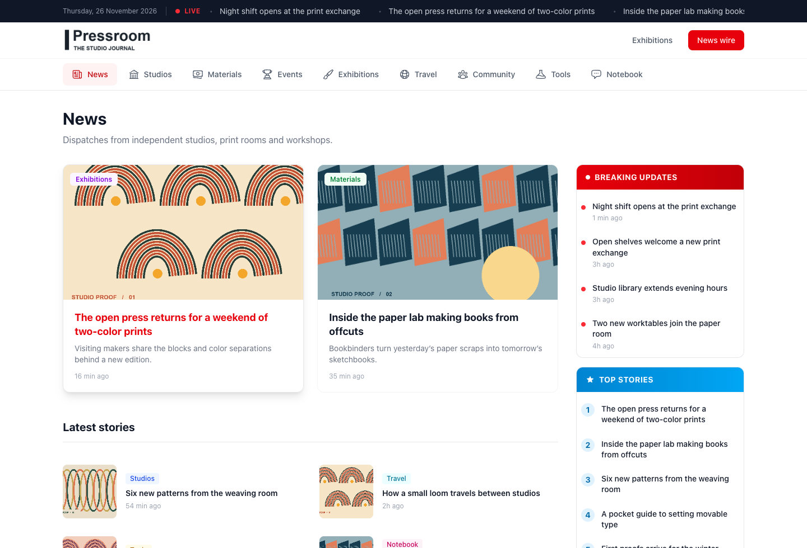
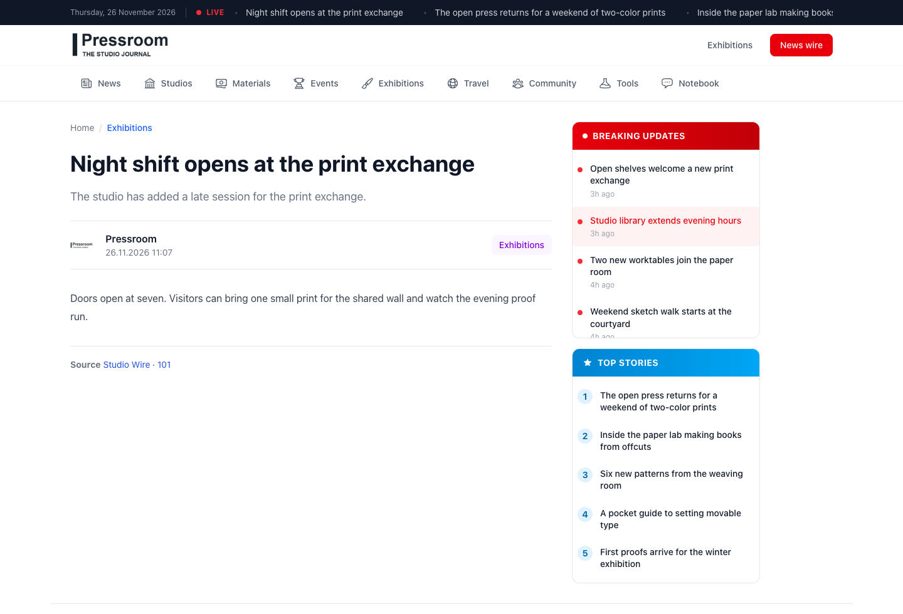

# Pressroom · Telegram Newsroom

A reader can open a breaking headline and follow it back to the exact dispatch it came from. Pressroom pairs a scrolling news wire with illustrated lead stories, category pages and a separate rail for short, text-only updates.



## Read one dispatch from end to end

With Git and Docker Compose installed, run:

```sh
git clone https://github.com/Dror-Bengal/telegram-newsroom.git
cd telegram-newsroom
docker compose up -d --build --wait
```

Open [the local edition](http://localhost:18792). The first run imports 15 fictional studio dispatches, including ten illustrated stories. All pages read published records from the edition database.

To put a new bulletin on the wire:

```sh
docker compose exec desk python newsroom.py replay examples/bulletin.json
```

Refresh the homepage and open **Night shift opens at the print exchange** in **Breaking updates**. The headline also runs on the top ticker. The article includes the full copy and an attribution link to sample message **Studio Wire · 101**. Replaying it preserves the article URL and creates a single article for that message.



## How it works

1. The live collector reads messages through Telethon using a Telegram user session. The local replay constructs Telethon message objects from JSON. Both use the original channel parser and the same storage and publishing functions.
2. The collector saves each source message under its channel and message IDs. The local wire editor takes the headline, standfirst and paragraphs from the dispatch and reads an optional category tag. Source text is escaped before rendering. An optional Gemini editor can group several messages, skip repeats and retain attribution to each source.
3. The publisher writes the article and acknowledges its inputs in one SQLite transaction. The site reads the resulting edition on each page request. Text dispatches appear in the breaking rail, while illustrated dispatches supply the lead cards. The ticker carries recent headlines from both.
4. Demo source links open the exact input stored locally. Live source links point to the public Telegram message. Captioned Telegram photos are downloaded to the edition volume. The local reader binds to loopback. The storage service runs inside Compose.

The homepage, ticker, category and article templates are adapted from the original Next.js reader. Branding, language, artwork and news copy in this edition are neutral portfolio material. SQLite replaces the hosted Firestore and media storage for a reproducible checkout. The demo uses deterministic editing without API credentials.

## Run the checks

```sh
docker compose exec desk python -m unittest -v test_newsroom
```

The worker tests cover channel-scoped replay, incremental Telegram polling with a simulated transport, source attribution, transaction recovery and validation of clustered editorial output.

For the browser check, start a **fresh checkout and Compose volume**, then use Python 3.11+ on the host:

```sh
python3 -m venv .venv
. .venv/bin/activate
pip install playwright
python -m playwright install chromium
python tests/browser.py --clean
```

This checks that the bulletin is absent, replays it twice, expects the count to rise from 15 to 16, opens the article from the breaking rail, follows its source, and checks the illustrated lead, category and mobile navigation. On an edition that already contains the bulletin, run the same command without `--clean`. Set `BROWSER_CHANNEL=chrome` to use an installed Chrome. The database and downloaded photos live in the named `edition` volume and survive `docker compose down`. Use `NEWSROOM_PORT` to run on another loopback port.

## Optional connected mode

Set `TELEGRAM_API_ID`, `TELEGRAM_API_HASH`, `TELEGRAM_SESSION` (an authorized Telethon string session) and `TELEGRAM_CHANNELS` (a comma-separated list of public channel usernames) in your local shell or an ignored `.env` file. Start the worker with `docker compose --profile live up -d --build --wait`. The collector initially reads the latest 50 messages per channel, then polls after its saved cursor. It handles text and captioned photos. The default editor publishes the dispatch as supplied. To start a connected edition without the sample stories, set `SEED_EDITION=0` before the first launch with a new volume.

To enable the optional batch editor, also set `EDITOR_MODE=gemini`, `GEMINI_MODEL` and `GEMINI_API_KEY`. This sends the selected source text and recent headlines to the configured model. A failed or incomplete model response leaves the batch pending for retry. The default demo and automated tests run locally with both external services disconnected.

## License

Nayto’s code is distributed under the [MIT License](LICENSE). Third-party software and media retain their respective terms.
